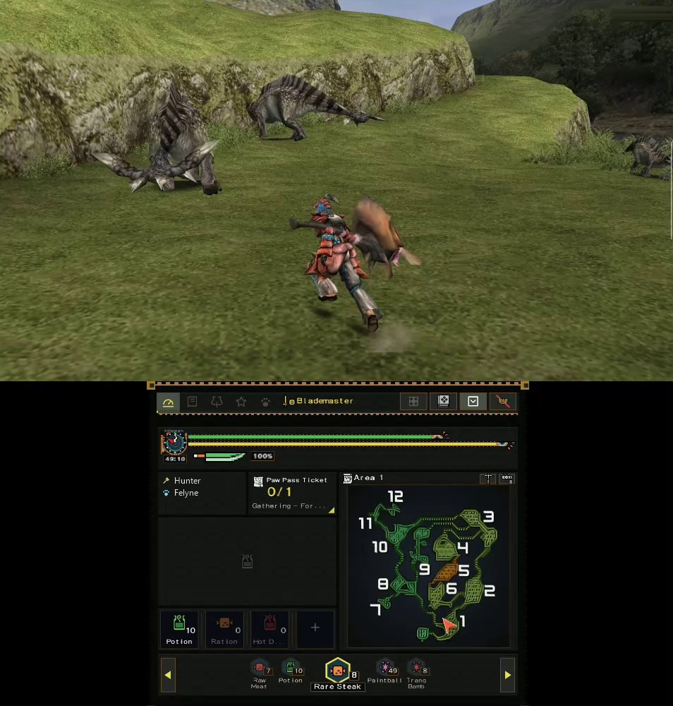
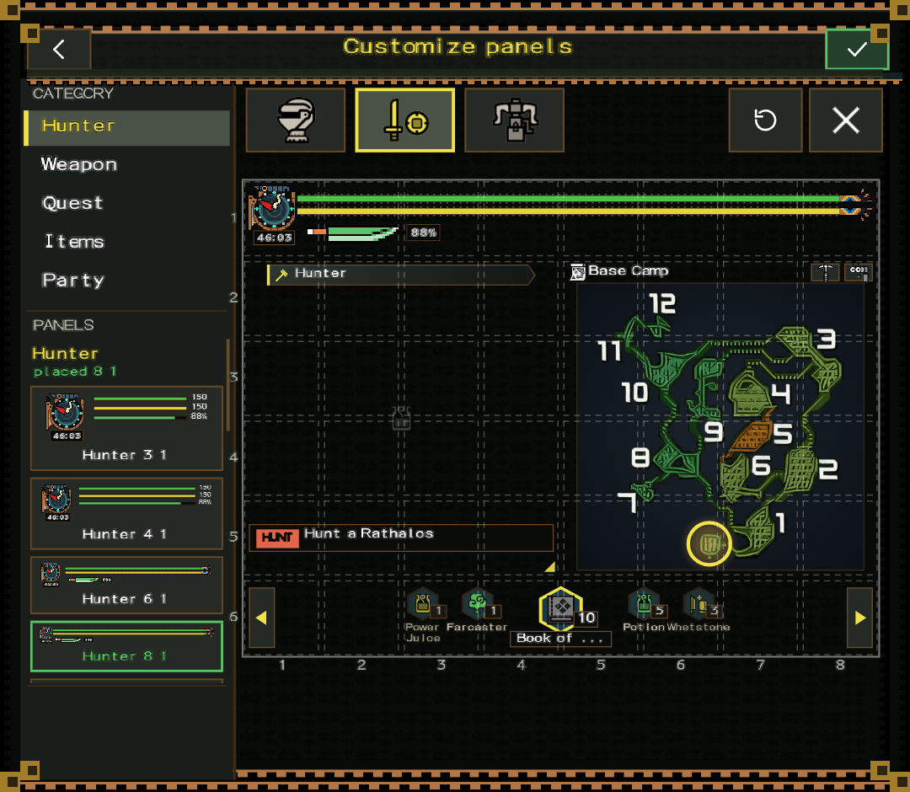

# AYN Thor PPSSPP Companion

Version 0.1.0, the initial build. See the [changelog](CHANGELOG.md).

A personal, vibe-coded mod of the [PPSSPP](https://www.ppsspp.org) emulator for the **AYN Thor**, a dual-screen
Android handheld. The game runs on the top screen. The bottom screen shows a live companion for
**Monster Hunter Freedom Unite** (FUComplete, `ULJM05500`) that reads the game's memory.

> **Disclaimer.** This was built for my own use on my own Thor, with heavy help from an AI coding assistant
> ("vibe-coded"). It is shared as is, in case it's useful or fun for someone else. It is not affiliated with or
> endorsed by the PPSSPP team or Capcom. Expect rough edges, and keep backups of your saves.



## Download

1. Get the APK (`MM-PSP-0.1.0.apk`) from the [Releases](https://github.com/moomootheseacow/AYN-Thor-PPSSPP-Companion/releases)
   page.
2. On your Thor, allow installs from unknown sources for the app you open it with (your browser or file manager),
   then open the APK to install it.
3. It installs as its own app, "M&M PSP", next to the official PPSSPP, and uses the same PSP folder for your
   games and saves.
4. On first launch it asks for your PSP folder, like the official PPSSPP. Pick the same folder the official app uses
   to share games and saves with it.
5. Bring your own game: no game files are included. See [Bring your own game](#bring-your-own-game).

What you need:

- **A dual-screen device such as the AYN Thor.** The companion draws on the second screen. On a phone with one
  screen it's plain PPSSPP.
- **Monster Hunter Freedom Unite, FUComplete (`ULJM05500`).** That's the version it's tested on. The companion
  turns on by itself when this game starts; with any other game it's plain PPSSPP. The US and EU releases are
  recognised but not tested, so the HUD may show wrong values on them.
- **Optional: "Display over other apps".** Android asks for it the first time you tap Minimize; the floating restore
  button needs it. Without it, minimize shows a black screen with a restore tab instead.

## New features compared to base PPSSPP

- **Dual-screen companion.** A second window on the Thor's bottom screen, running next to the game and driven by
  Lua packages that read the running game's memory.
- **Monster Hunter Freedom Unite hunt HUD** on the bottom screen:
  - health and stamina, sharpness and weapon gauges, the quest timer;
  - the area map, with gather spots;
  - the item bar with names and counts (change items from the bottom screen), gunner ammo and coatings;
  - status buffs with countdowns, Felyne plates, quest goals with a quest card;
  - Quick use panels, and the game's own red X on items that can't be used right now.
- **Two layouts.**
  - Immersive (the default).
  - Custom: a grid you arrange yourself in the village (place, resize and remove panels), saved separately for
    Blademaster and Gunner.

  

- **Clean top screen.** The game's own HUD can be hidden on the top screen while the bottom screen shows it.
- **Minimize** the bottom screen, with a floating button to bring it back.
- **Logs screen** in the app, with Copy for bug reports.
- **Its own app.** It installs as `org.ppsspp.ppsspp.thorcompanion`, next to the official PPSSPP, with its own
  launcher icon and name.
- **Experimental (work in progress): the Meowtfitter and transmog.**
  - A cat NPC in Pokke Village with his own greeting.
  - A look for each armour piece: your hunter wears the look and keeps the real armour's stats, in the village
    only, and nothing is written to your save.
  - Current state: he isn't drawn yet (you can talk to him but not see him), and a new look shows after you re-equip
    any piece at your item box.

Engine additions for package authors: Lua 5.4, safe game-memory reads and writes, code patches applied on the
emulator thread, simulated button presses, a memory watch (built on PPSSPP's memory checks) and RAM dumps for research.

## What's here

| Path | What it is |
|---|---|
| `Companion/` | The companion engine (C++): the Lua runtime, bottom-screen drawing, memory access, code patches, button presses, memory watch. |
| `android/src/org/ppsspp/ppsspp/companion/` | The Android side: the bottom-screen window and the bridge to the engine. |
| `assets/companion/mhfu/` | The Monster Hunter Freedom Unite package (Lua, images, maps). |
| `thor-companion/docs/` | `PACKAGES.md` (how to write a game package) and `TRANSMOG_PROBE.md` (Meowtfitter and transmog research: memory layouts and findings). |
| `thor-companion/tests/` | PC tests for the Lua package (Python plus [lupa](https://pypi.org/project/lupa/)). |
| `Core/Debugger/Breakpoints.*`, `Core/HLE/sceDisplay.cpp`, `CMakeLists.txt`, `android/…` | Small hooks into PPSSPP, each marked "Thor Companion". |

Everything else is PPSSPP v1.20.4, unchanged. PPSSPP's own README is in [README_PPSSPP.md](README_PPSSPP.md).

## Building

It builds like PPSSPP for Android. See [README_PPSSPP.md](README_PPSSPP.md) for the toolchain.

```
git submodule update --init --recursive
./gradlew :android:assembleNormalOptimized
```

## Bring your own game

No game files are included. You need your own copy of Monster Hunter Freedom Unite (FUComplete, `ULJM05500`).
The companion only reads and writes the running game's memory. It never writes your save file.

## Tests

```
pip install lupa
python thor-companion/tests/harness7p.py <folder with lupa> assets/companion/mhfu thor-companion/tests/test7q.lua
python thor-companion/tests/harness7p.py <folder with lupa> assets/companion/mhfu thor-companion/tests/test7r3.lua
```

The Meowtfitter and transmog tests (`pre7r2.lua` + `body7ag5.lua`) run against a RAM dump of your own game, with `DEV = true` (they check the research buttons too). To get
the Dump button on the Logs screen, set `DEV = true` at the top of `assets/companion/mhfu/main.lua` and rebuild.
Dumps are never part of this repo.

## License

PPSSPP is licensed under the GNU GPL v2 or later (see [LICENSE.TXT](LICENSE.TXT)), and so is this mod. All credit for the
emulator goes to the PPSSPP team. Monster Hunter is a trademark of Capcom; the game images in the MHFU package
belong to Capcom. The launcher icon is new artwork for this mod around PPSSPP's own logo.
